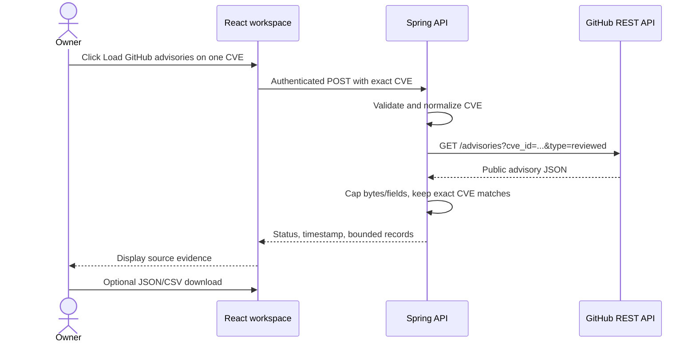

# GitHub Advisory Database lookup

## Goal and scope

This M7 slice adds a second independently selectable advisory source next to OSV. The owner can request reviewed GitHub Advisory Database records for one exact CVE from an existing finding. It does not search arbitrary text, access a GitHub account, download a repository, inspect package inventories, or make a risk decision.

GitHub documents a public `GET /advisories` endpoint with the `cve_id` filter. AURA uses this official endpoint without authentication and asks for `type=reviewed`; unreviewed and malware records are excluded. The endpoint may return several advisories for one CVE.

## Data flow



The API is the trust boundary. It never accepts a caller-supplied URL. GitHub receives only the CVE identifier; package names, local versions, the SBOM/SARIF file, authentication credentials, and research documents are not sent. Search is a separate explicit action.

## API contract

`POST /api/v1/cyber/vulnerabilities/github-advisories/lookup`

Request:

```json
{ "cve": "CVE-2024-12345" }
```

Requires the local owner's Basic Auth credentials. The response has `AVAILABLE`, `NOT_FOUND`, `RATE_LIMITED`, or `UNAVAILABLE` status, the retrieval time, and up to ten records. A record can include GHSA and CVE IDs, summary/description, severity, publication/review dates, CVSS v3/v4 vectors and scores, CWE IDs, package ecosystem/name/version notes, and HTTPS references. JSON downloads include the full in-session response; CSV downloads include status, GHSA IDs, and summaries.

## Bounded provider behavior

- Fixed host and endpoint: `api.github.com/advisories`; no account token.
- Query parameters: the normalized exact CVE, `type=reviewed`, and `per_page=10`.
- Redirects disabled; eight-second connect/read timeout; no retries.
- Response body limited to 256 KiB.
- The server accepts a row only if its `cve_id` or typed `identifiers[]` contains the exact requested CVE.
- Text, URLs, package/CWE/reference counts, and records have fixed caps. Only HTTPS references are included; links are shown, never fetched.
- Successful and not-found results use a six-hour memory-only cache capped at 500 CVEs. Rate-limited and unavailable outcomes are not cached.
- The UI keeps results in memory until disconnect/reload; only a deliberate download creates a user-controlled export. AURA does not persist these responses.

## Components

| Component | Responsibility |
|---|---|
| `LookupGitHubAdvisoryRequest` | Validate one exact CVE ID at the API boundary |
| `GitHubAdvisoryLookupController` | Expose the authenticated POST route |
| `GitHubAdvisoryLookupService` | Normalize the ID and map provider data into the HTTP response |
| `GitHubAdvisoryProvider` | Fixed outbound request, timeout/redirect policy, response cap, exact-CVE check, bounded parsing, and cache |
| `GitHubAdvisoryData` | Immutable source data model with bounded nested records |
| `App.tsx` and `api.ts` | Explicit per-finding action, status/display, and JSON/CSV export |

## What the data means

GitHub labels records by review type and can include severity, CVSS, package/version range, CWE, and reference information. These are advisory-source statements. CVSS describes vulnerability severity; it is not a score for AURA's user's particular asset. Package strings/ranges are not proof that the owner's package is present or vulnerable. The UI therefore does not auto-match them against the uploaded inventory. Use NVD and OSV as other separate sources and review disagreements at their source links.

GitHub's API is rate-limited. AURA reports rate limiting and does not automatically retry. A `NOT_FOUND` means no matching reviewed record was returned by this bounded query at retrieval time; it does not prove that no vendor advisory exists.

## Test strategy

Provider tests use a mock HTTP server to verify the exact query and pinned API version, parsing of supported advisory fields, CVE-match enforcement, safe-link filtering, caching, and no-retry handling for HTTP 429. An authenticated API test verifies local-owner authentication, response shape, and rejection of a non-CVE string. CI compiles and runs the backend suite along with web checks and Compose build.

## Learning and interview guide

Learn Spring `RestClient` request/response handling, JSON tree parsing, API validation, HTTP timeouts/statuses, in-memory bounded caches, and the distinction between a source assertion and an asset-specific conclusion. The provider deliberately stays a typed adapter behind the application service instead of letting UI code call GitHub directly; this keeps credentials, validation, response caps, and source parsing on the server.

**Interview explanation:** “For additional vulnerability context, AURA exposes an authenticated, user-triggered lookup for one exact CVE. The backend sends that identifier to GitHub's public reviewed-advisory endpoint, enforces an exact match, bounds time, response size, fields, and cache, and returns source evidence without sending the SBOM or making an asset match. Results remain ephemeral unless the user exports them.”

## Source

GitHub, [REST API endpoints for global security advisories](https://docs.github.com/en/rest/security-advisories/global-advisories). The documentation describes public unauthenticated access for public resources, the `cve_id` filter, the `type` filter, paging, and rate-limit/validation status codes.
