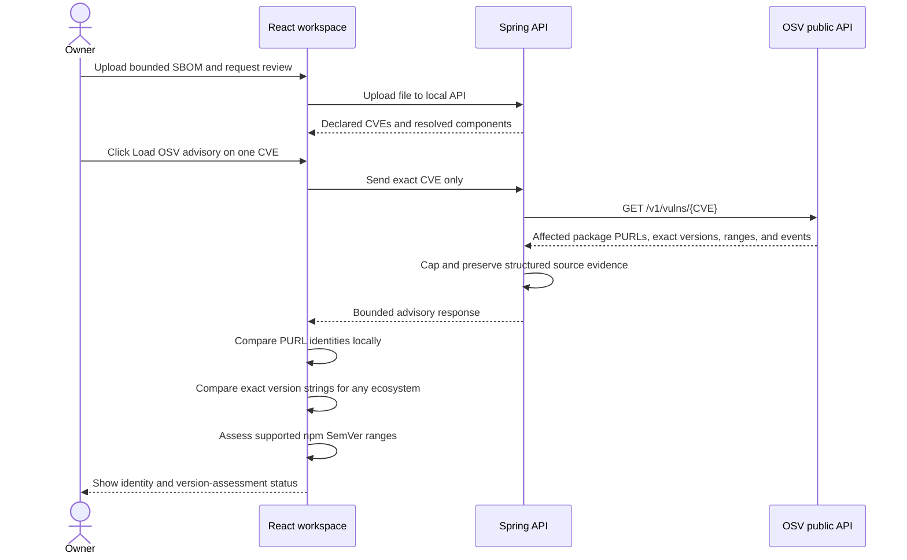

# Local SBOM and OSV package correlation

## Goal

After the owner explicitly loads OSV details for a CVE declared in an SBOM, AURA can correlate OSV affected-package records with the local components already linked to that CVE. The browser compares PURL identity, literal affected-version entries for any ecosystem, and (for npm only) complete SemVer 2 range evidence against the local component version. Package inventory is never sent to OSV.

## Data flow

Only the explicitly selected CVE leaves the UI. Correlation and version assessment use the existing OSV response and local SBOM response in memory; they make no follow-up network request and are not persisted. JSON/CSV exports happen only after an explicit download action.

## Package identity rule

The helper in `web/src/sbomAdvisoryCorrelation.ts` compares bounded PURLs of a minimum `pkg:type/path` shape. It lowercases the type, removes a version delimiter only when it occurs after the final slash, ignores subpaths, and otherwise preserves package path and qualifiers exactly. It does not decode, sort, or guess aliases; missing or differently encoded PURLs do not fall back to package names.

## Version-assessment rule

Version assessment runs only when all of these are true:

- OSV returned an available, non-withdrawn advisory for the exact requested CVE.
- The local component and OSV package share the exact PURL identity above.
- The SBOM component has a version.
- For an exact-version result, the local version exactly equals an OSV `affected[].versions` entry. Literal equality does not interpret or normalize ecosystem versions.
- For range comparison, OSV's package ecosystem is exactly `npm`; OSV supplied complete `SEMVER` range events in the supported event shape; and both range boundaries and local version are strict SemVer 2.

The client uses `semver` 7.8.5 in strict mode for npm ranges. It handles `introduced` including the OSV sentinel `0`, exclusive `fixed`, inclusive `last_affected`, and `limit` events. It requires valid, alternating introduction/end boundaries and refuses ambiguous or malformed event sequences. SemVer 2 ranges have SemVer ordering; OSV `ECOSYSTEM` ranges use ecosystem-specific ordering and are intentionally not compared. OSV's schema distinguishes exact listed versions, `SEMVER`, `ECOSYSTEM`, and `GIT` ranges; see the [OSV schema](https://ossf.github.io/osv-schema/). The [npm SemVer library](https://www.npmjs.com/package/semver) provides strict parsing and comparison.

Each local component gets one of these results:

- `AFFECTED`: an exact version-list entry matches in any ecosystem, or a supported npm range matches.
- `NO_MATCH_IN_RETURNED_OSV_VERSION_DATA`: the complete returned version evidence was supported and no match was found. This is not proof that software is safe outside this OSV record or its stated coverage.
- `NOT_ASSESSED`: missing version/evidence, withdrawn record, non-npm ecosystem, unsupported range type, malformed SemVer/event sequence, or truncated evidence.

An exact returned affected-version entry can still support a positive match if unrelated range data was truncated. A range match is reported only when all range evidence is complete, because later events can close a partially returned range. Any truncated data prevents a negative result. A PURL identity match by itself does not mean a version is vulnerable. None of these statuses establishes that a component is installed, reachable, exploitable, exposed, or a material risk to an organization.

## Bounded API data

The fixed OSV provider response remains capped at 256 KiB, 20 affected packages, and 10 range entries per package. It now also returns up to 100 exact affected versions, up to 50 structured events per range, display strings for those ranges, and truncation flags. Event keys are preserved in a typed response and an invalid event shape is marked as invalid so the browser cannot silently treat it as a complete range.

## Exports

SBOM JSON exports include the exact PURL match basis, assessment policy `EXACT_OSV_VERSIONS_ANY_ECOSYSTEM_NPM_SEMVER_2_RANGES`, per-component version-assessment statuses, supporting evidence, and coverage limitation. CSV exports include the policy, each matched component's assessment status, exact identity match count, and local component labels. OSV responses and correlation are not written to the database.

## Testing

Backend provider tests cover structured OSV version data, malformed payload shapes, and independent version/range caps. Browser unit tests cover exact PURL matching, SemVer boundaries and prereleases, `introduced: 0`, disjoint ranges, `fixed`, `last_affected`, `limit`, exact listed versions, missing/invalid versions, unsupported ecosystems/types, malformed events, truncation, and withdrawn records. The UI integration test confirms the explicit exact-CVE request, local assessment, and JSON/CSV export.

## Code and learning prompts

- `backend/src/main/java/ai/aura/api/cyber/OsvProvider.java` — fixed outbound lookup, response caps, and structured event parsing.
- `backend/src/main/java/ai/aura/api/cyber/OsvVulnerabilityData.java` — bounded source data model.
- `web/src/sbomAdvisoryCorrelation.ts` — exact PURL identity and strict local npm SemVer assessment.
- `web/src/sbomAdvisoryCorrelation.test.ts` — version-boundary regression fixtures.
- `web/src/App.tsx` — user-visible limits and explicit exports.

Explain why range identity and version ordering are separate decisions, why exact package names are insufficient, and why `NOT_ASSESSED` is safer than comparing a range whose ecosystem semantics are unsupported. Propose the fixture requirements before adding another package ecosystem.
