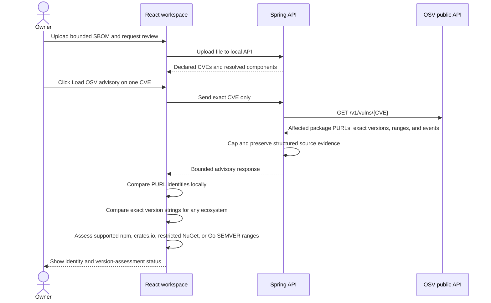

# Local SBOM and OSV package correlation

## Goal

After the owner explicitly loads OSV details for a CVE declared in an SBOM, AURA can correlate OSV affected-package records with the local components already linked to that CVE. The browser compares PURL identity, literal affected-version entries for any ecosystem, and complete npm, crates.io, restricted NuGet, or Go module SemVer 2 range evidence against the local component version. Package inventory is never sent to OSV.

## Data flow

Only the explicitly selected CVE leaves the UI. Correlation and version assessment use the existing OSV response and local SBOM response in memory; they make no follow-up network request and are not persisted. JSON/CSV exports happen only after an explicit download action.

## Package identity rule

The helper in `web/src/sbomAdvisoryCorrelation.ts` compares bounded PURLs of a minimum `pkg:type/path` shape. It lowercases the type, removes a version delimiter only when it occurs after the final slash, ignores subpaths, and otherwise preserves package path and qualifiers exactly. It does not decode, sort, or guess aliases; missing or differently encoded PURLs do not fall back to package names.

## Version-assessment rule

Version assessment runs only when all of these are true:

- OSV returned an available, non-withdrawn advisory for the exact requested CVE.
- The local component and OSV package share the normalized PURL identity above; for NuGet, the package ID comparison is case-insensitive.
- The SBOM component has a version.
- For exact-version evidence, local versions are compared literally for every ecosystem. NuGet also compares strict supported versions using NuGet's SemVer precedence (which ignores build metadata); uppercase prerelease labels or non-three-part forms are left `NOT_ASSESSED` unless the exact strings match.
- For range comparison, OSV's package ecosystem is exactly `npm`, `crates.io`, `NuGet`, or `Go`; OSV supplied complete `SEMVER` range events in the supported event shape; and both range boundaries and local version are strict SemVer 2. Cargo versions require exactly three numeric components; build metadata is accepted but ignored for precedence. NuGet is limited to exactly three numeric version components and lowercase prerelease labels because NuGet accepts additional version shapes and compares prerelease labels without case sensitivity.
- Go module versions and range boundaries must use canonical `v`-prefixed SemVer strings. The evaluator accepts `+incompatible` build metadata, which Go ignores for ordering, and rejects other build metadata. It does not validate the module path's major-version suffix or pseudo-version timestamp/ancestry.

The client uses `semver` 7.8.5 for strict npm and crates.io ranges, a restricted NuGet subset, and Go's v-prefixed version form. Cargo versions require canonical SemVer 2 with exactly three numeric components and no `v` prefix; prerelease ordering follows SemVer, and build metadata is ignored for precedence. This compares version precedence only and does not reproduce Cargo dependency requirement matching. NuGet PURL package IDs must match AURA's ASCII package-ID subset before they are compared without case. NuGet versions are assessed only when they have exactly three numeric components and any prerelease label is lowercase. NuGet also accepts abbreviated and four-component versions and compares prerelease labels case-insensitively, so AURA leaves those forms `NOT_ASSESSED`; build metadata is ignored for precedence. The evaluator handles `introduced` including the OSV sentinel `0`, exclusive `fixed`, inclusive `last_affected`, and `limit` events. It requires valid, alternating introduction/end boundaries and refuses ambiguous or malformed event sequences. The supported Go subset follows the Go module reference's SemVer precedence: pre-releases sort before releases and build metadata does not change order. AURA does not reproduce `go` command checks for pseudo-version ancestry or module-path consistency. OSV `ECOSYSTEM` ranges use ecosystem-specific ordering and are intentionally not compared; unsupported ecosystem-specific ranges therefore remain `NOT_ASSESSED`. OSV's schema defines `SEMVER` ranges by SemVer 2.0 precedence and distinguishes them from ecosystem-specific ranges; see the [OSV schema](https://ossf.github.io/osv-schema/). The Cargo manifest reference specifies SemVer package versions and informational build metadata; see [The Cargo Book](https://doc.rust-lang.org/cargo/reference/manifest.html). Rust's [`semver` crate](https://docs.rs/semver/latest/semver/struct.Version.html) documents strict parsing and SemVer precedence. Microsoft's [NuGet package version reference](https://learn.microsoft.com/en-us/nuget/concepts/package-versioning) documents NuGet normalization and comparison differences. The [NuGet package ID rule](https://learn.microsoft.com/en-us/nuget/reference/errors-and-warnings/nu1017) documents the accepted package-ID shape. The [npm SemVer library](https://www.npmjs.com/package/semver) provides the strict SemVer parser; [Go's module reference](https://go.dev/ref/mod#versions) documents Go module version formatting and ordering.

Each local component gets one of these results:

- `AFFECTED`: an exact version-list entry matches in any ecosystem, or a supported npm, crates.io, restricted NuGet, or Go `SEMVER` range matches.
- `NO_MATCH_IN_RETURNED_OSV_VERSION_DATA`: the complete returned version evidence was supported and no match was found. This is not proof that software is safe outside this OSV record or its stated coverage.
- `NOT_ASSESSED`: missing version/evidence, withdrawn record, unsupported ecosystem/range type, malformed SemVer/event sequence, invalid Go version form, or truncated evidence.

An exact returned affected-version entry can still support a positive match if unrelated range data was truncated. A range match is reported only when all range evidence is complete, because later events can close a partially returned range. Any truncated data prevents a negative result. A PURL identity match by itself does not mean a version is vulnerable. None of these statuses establishes that a component is installed, reachable, exploitable, exposed, or a material risk to an organization.

## Bounded API data

The fixed OSV provider response remains capped at 256 KiB, 20 affected packages, and 10 range entries per package. It now also returns up to 100 exact affected versions, up to 50 structured events per range, display strings for those ranges, and truncation flags. Event keys are preserved in a typed response and an invalid event shape is marked as invalid so the browser cannot silently treat it as a complete range.

## Exports

SBOM JSON exports include the exact PURL match basis, assessment policy `EXACT_OSV_VERSIONS_ANY_ECOSYSTEM_NPM_CRATES_IO_NUGET_GO_SEMVER_2_RANGES`, per-component version-assessment statuses, supporting evidence, and coverage limitation. CSV exports include the policy, each matched component's assessment status, exact identity match count, and local component labels. OSV responses and correlation are not written to the database.

## Testing

Backend provider tests cover structured OSV version data, malformed payload shapes, and independent version/range caps. Existing browser unit tests cover exact PURL matching and npm SemVer boundaries, prereleases, `introduced: 0`, disjoint ranges, `fixed`, `last_affected`, `limit`, exact listed versions, missing/invalid versions, unsupported ecosystems/types, malformed events, truncation, and withdrawn records. Cargo fixtures cover prerelease and fixed boundaries, ignored build metadata, and rejected abbreviated, prefixed, or four-part versions. The Go range extension uses the same bounded event state machine with Go's mandatory `v` prefix and ordering rules; dedicated Go pseudo-version fixtures remain a follow-up. The UI integration test confirms the explicit exact-CVE request, local assessment, and JSON/CSV export.

## Code and learning prompts

- `backend/src/main/java/ai/aura/api/cyber/OsvProvider.java` — fixed outbound lookup, response caps, and structured event parsing.
- `backend/src/main/java/ai/aura/api/cyber/OsvVulnerabilityData.java` — bounded source data model.
- `web/src/sbomAdvisoryCorrelation.ts` — normalized PURL identity and strict local npm, crates.io, restricted NuGet, and Go SemVer assessment.
- `web/src/sbomAdvisoryCorrelation.test.ts` — version-boundary regression fixtures.
- `web/src/App.tsx` — user-visible limits and explicit exports.

Explain why range identity and version ordering are separate decisions, why exact package names are insufficient, and why `NOT_ASSESSED` is safer than comparing a range whose ecosystem semantics are unsupported. Propose the fixture requirements before adding another package ecosystem.
