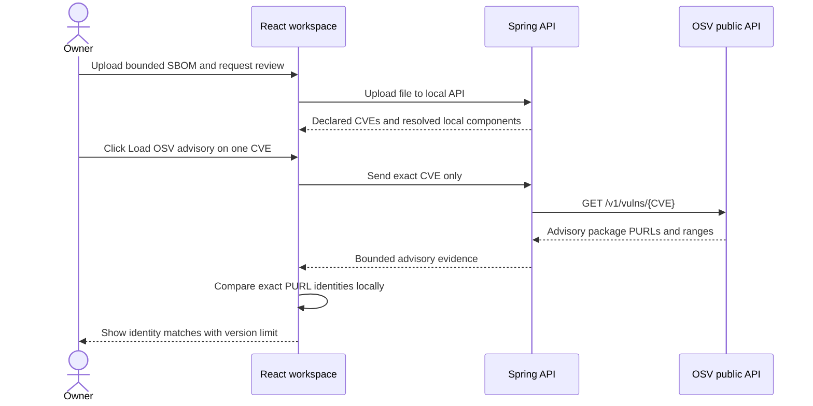

# Local SBOM and OSV package identity correlation

## Goal

When the owner explicitly loads OSV details for a CVE declared in an SBOM, AURA can show whether an OSV affected-package entry and one of that finding's local components share the same Package URL identity. The comparison runs in the browser from the existing responses. It makes no extra network request and never sends the SBOM to OSV.

## Data flow

## Match rule

The helper in `web/src/sbomAdvisoryCorrelation.ts` accepts only PURLs up to 4,096 characters beginning with `pkg:` and a valid type/path shape. It lowercases the PURL type, removes the version delimiter only when it appears after the last slash, and otherwise requires the remaining PURL string, including qualifiers, to match exactly. It does not compare names alone, normalize namespaces, sort/decode qualifiers, or guess aliases. The advisory PURL may omit a version; the local component PURL may include one.

The result is labeled **exact PURL identity only**. The code does not compare an inventory version against OSV's `SEMVER`, `ECOSYSTEM`, or `GIT` events. It does not decide that software is affected, installed, reachable, exploitable, or at risk. A missing exact PURL match is not proof that the advisory is unrelated; source IDs may be missing or encoded differently.

## API and exports

No backend route or schema change is needed: the SBOM lookup already returns locally resolved component PURLs and OSV returns affected package PURLs. Only after an explicit per-CVE OSV action does the UI join the two in memory. SBOM JSON exports include `osvPackageCorrelations` with the exact match basis, `versionAssessment: NOT_PERFORMED`, and a limitation. CSV exports add the match basis, `NOT_PERFORMED` assessment, exact-PURL match count and matching local component labels. JSON and CSV are downloaded only after an explicit owner action; the API and database do not persist the derived correlation.

## Tests

Pure helper tests cover exact matches across differing versions, namespace/ecosystem separation, absent/malformed PURLs, and the boundary between identity and version applicability. The UI test checks the explicit OSV request, local match rendering, and exported limitation. Java tests remain unchanged because correlation does not occur in the backend.

## Learning prompt

Explain why identity lookup is a separate stage from version applicability. Then independently add a small test for one supported PURL qualifier. Before implementing version matching, define supported ecosystems and source-specific range formats, then build a curated boundary-case fixture set.
