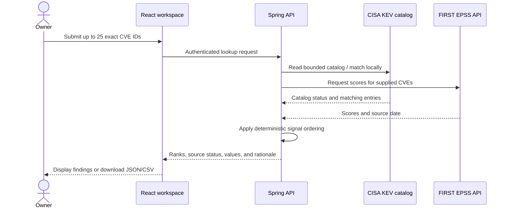

# Vulnerability signal ordering and evaluation

## Purpose

AURA orders an explicitly supplied set of CVEs using two public signals: a CISA Known Exploited Vulnerabilities (KEV) catalog match and a FIRST EPSS probability estimate. The output is a review aid for deciding which source records to inspect first. It is not an asset-specific risk score, a remediation deadline, or a claim that a CVE affects a local package.

## Current rule

1. CVEs present in the returned KEV snapshot appear first.
2. Remaining CVEs with EPSS data sort by descending EPSS score.
3. Findings without EPSS data sort after findings with a score.
4. Equal EPSS scores and rows with no comparative signal retain the user's input order.
5. If KEV is unavailable, `knownExploited` is `null`; AURA does not claim that a CVE is absent from KEV. When a stale snapshot is used, a positive KEV match remains visible, but its rationale says that the snapshot is stale. A negative means only “not in this snapshot.”

KEV membership is a categorical signal for known exploitation reported by CISA; EPSS estimates exploitation probability over the next 30 days. They describe different things, so AURA does not combine them into an invented numeric score. CVSS, due dates, ransomware-use metadata, package presence, asset exposure, business criticality, and compensating controls do not currently affect this ordering.

## Data flow

The browser sends CVE identifiers to AURA. The backend owns provider calls, exact ID matching, ordering, and source-status interpretation. The response keeps provider timestamps and availability visible. The uploaded SBOM is parsed locally in the UI; only declared CVE IDs are used for the existing enrichment request.

## Regression evaluation scenarios

The fixture-based service tests use synthetic records; they do not use live provider data or imply predictive accuracy.

| Scenario | Synthetic evidence | Expected result |
|---|---|---|
| Known exploitation outranks probability | KEV match EPSS 0.01; non-KEV CVE EPSS 0.99 | KEV match is first; other rows sort by EPSS |
| EPSS ordering | Non-KEV scores 0.90 and 0.20 | 0.90 appears first |
| Stable ties and missing scores | Two equal scores entered in a known order; another CVE has no score | Preserve tie input order; missing score follows scored rows |
| Stale catalog | One positive match and one non-match in a stale snapshot | Keep positive evidence, label it stale, and describe a non-match only against the stale snapshot |
| KEV unavailable | EPSS scores exist but catalog lookup fails | Sort by EPSS and leave `knownExploited` unknown |
| No comparative evidence | Empty catalog and no EPSS results | Preserve input order and state that no matching signal was returned |

These are deterministic regression checks for the implemented ordering contract. They do not measure precision, recall, calibration, or remediation outcomes. A defensible risk-ranking evaluation needs a labeled set of actual assets, package/version confirmation, reachability/exposure, business impact, and an agreed remediation objective. Until that data exists, adding a weighted “risk score” would create false precision.

## Limits and next steps

- Ranking is relative only to the CVEs supplied in one request.
- Missing or stale provider data is surfaced; no data is not treated as evidence of safety.
- CISA due dates and ransomware-use fields remain source context, not universal priorities; due dates can be policy-specific.
- A CVE listed in a report is not proof that the installed package/version is affected. AURA does not yet evaluate CPE or ecosystem-specific advisory ranges.
- A later asset-aware model should define supported evidence, scenario-specific expected ordering, and known-answer fixtures before changing the ranking rule. Keep the deterministic baseline and report coverage before describing any result as validated.

## Learning and interview prompts

- Explain why KEV membership is ordered before EPSS, and why the two values should not be added as if they shared a unit.
- Explain how `null` differs from `false` for a KEV result and how stale-source status changes what a negative result means.
- Explain why regression fixtures verify ordering behavior but cannot establish real-world risk prediction quality.
- Propose one asset-context signal and define the evidence and labeled cases needed to test it without claiming certainty.

## Code and tests

- `backend/src/main/java/ai/aura/api/application/VulnerabilityLookupService.java` — data aggregation, ordering, and rationale.
- `backend/src/main/java/ai/aura/api/api/VulnerabilityLookupResponse.java` — ranking and source-status response.
- `backend/src/test/java/ai/aura/api/application/VulnerabilityPriorityEvaluationTest.java` — synthetic scenario regression suite.
- `backend/src/test/java/ai/aura/api/application/VulnerabilityLookupServiceTest.java` — source failure and stale-snapshot behavior.
